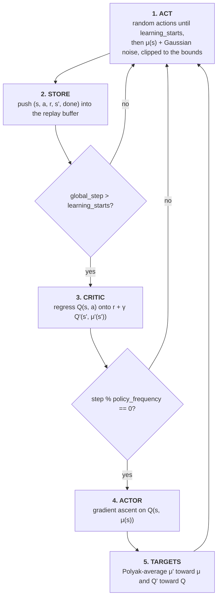

# DDPG Implementation

An implementation of **Deep Deterministic Policy Gradient** ([Lillicrap et al.,
2015](https://arxiv.org/abs/1509.02971)) in the CleanRL single-file style, following CleanRL's
[`ddpg_continuous_action.py`](https://github.com/vwxyzjn/cleanrl/blob/master/cleanrl/ddpg_continuous_action.py).
DDPG is what DQN becomes when the action is a real-valued vector: the `argmax` over actions that DQN
relies on is no longer computable, so a second network, the **actor**, learns to output the action
that maximises the critic.

Default task is MuJoCo `Hopper-v4`, CleanRL's benchmark task for DDPG.

---

## How this differs from DQN and continuous PPO

| | DQN (`../dqn/`) | PPO continuous (`../ppo-continuous-actions/`) | DDPG (here) |
| --- | --- | --- | --- |
| Actions | discrete | continuous | continuous |
| Family | off-policy, value-based | on-policy policy gradient | off-policy actor-critic |
| What is learned | `Q(s, a)` for every action at once | a stochastic Gaussian policy plus `V(s)` | a deterministic policy `μ(s)` plus `Q(s, a)` |
| Acting | argmax over Q, epsilon-greedy | sample from the Gaussian | `μ(s)` plus Gaussian noise |
| Data | replay buffer | fresh rollout, discarded after use | replay buffer |
| Critic input | state only; one output per action | state only | state **and** action; one output |
| Stability device | hard-copied target network | clipped surrogate | Polyak-averaged target actor and critic |
| Update trigger | every `train-frequency` steps | every rollout boundary | every step after `learning-starts`; actor every `policy-frequency` steps |

---

## Layout

```text
ddpg/
├── algorithm.py       # arguments, actor and critic, and the training loop (entry point)
├── utils.py           # ReplayBuffer, the same one dqn/ uses
├── eval.py            # evaluation of a saved checkpoint
├── hugging_face.py    # optional model-card generation and Hub upload
├── pyproject.toml     # Poetry dependencies, the `hub` extra, and [tool.hf-jobs] defaults
└── requirements.txt   # pip-installable pins of the same versions
```

---

## Installation

```bash
cd ddpg
poetry install
```

```bash
cd ddpg
python -m venv .venv
.venv\Scripts\activate        # Windows
# source .venv/bin/activate   # macOS / Linux
pip install -r requirements.txt
```

Core pins are `torch` 2.13.0, `gymnasium[mujoco]` 1.3.0 and `mujoco` 4.0.0, on Python 3.10–3.13.
MuJoCo ships as a normal pip wheel, so no separate simulator install or licence is needed, on Windows
included.

`requirements.txt` is a full freeze of a working environment and already includes what
`--upload-model` needs. With Poetry, those two packages are an extra:

```bash
poetry install --extras hub
```

---

## Quick start

```bash
cd ddpg
python algorithm.py
tensorboard --logdir runs
```

Run it from this directory: `algorithm.py` does `from utils import ReplayBuffer`, a flat import that
only resolves when `ddpg/` is the working directory.

```bash
python algorithm.py --env-id HalfCheetah-v4 --seed 7
python algorithm.py --env-id Pendulum-v1 --total-timesteps 30000 --learning-starts 1000   # quick sanity check
python algorithm.py --save-model                    # train, then evaluate the checkpoint
```

Any Gymnasium environment with a `Box` action space works: the MuJoCo tasks (`Hopper`, `HalfCheetah`,
`Walker2d`, `Ant`, ...) and classic-control `Pendulum-v1` and `MountainCarContinuous-v0`. The default
is `Hopper-v4` because that is what CleanRL's published DDPG results use; Gymnasium prints a
deprecation warning for the v4 MuJoCo tasks and recommends v5 (`--env-id Hopper-v5`), whose scores
are not directly comparable with CleanRL's.

Runs are written to `runs/{env_id}__{exp_name}__{seed}__{timestamp}/`.

---

## How training works

Like DQN, DDPG is one loop over environment steps, with learning gated on step counters.



### Acting

For the first `--learning-starts` steps (25,000 by default) actions are sampled uniformly from the
action space, which fills the buffer with diverse data before either network is trusted. After that
the actor acts, with Gaussian noise added for exploration:

```math
a = \mathrm{clip}\big(\mu_\theta(s) + \epsilon,\ a_{\mathrm{low}},\ a_{\mathrm{high}}\big), \qquad \epsilon \sim \mathcal{N}\big(0,\ (\sigma \cdot \text{scale})^2\big)
```

where `σ` is `--exploration-noise` (0.1) and `scale` is half the width of each action dimension, so
the noise is 10% of the action range regardless of the environment's units. The original paper used
Ornstein-Uhlenbeck noise; like CleanRL and TD3, this uses plain Gaussian noise, which works as well
in practice.

### The critic target

The critic is trained like DQN's Q network, except the `max` over next actions is replaced by the
**target actor's** choice, since a maximum over a continuous action space can't be enumerated:

```math
y = r + \gamma \, (1 - d) \, Q_{\phi'}\big(s', \mu_{\theta'}(s')\big)
```

```math
L_Q = \big(y - Q_\phi(s, a)\big)^2
```

As in `dqn/`, only `terminations` is stored as the done flag, so a time-limit truncation keeps its
bootstrap. That matters more here than on CartPole: MuJoCo episodes are cut at 1,000 steps, and
treating that cut as a real terminal state would teach the critic that standing still at step 999
is worth nothing.

### The actor update

The actor is trained to output the action the critic scores highest. Because `Q_φ(s, a)` is
differentiable in `a`, the gradient flows from the critic's output back through the action into the
actor's weights (the deterministic policy gradient, [Silver et al.,
2014](https://proceedings.mlr.press/v32/silver14.html)):

```math
L_\mu = -\,\mathbb{E}_{s \sim \mathcal{D}}\big[\,Q_\phi\big(s, \mu_\theta(s)\big)\big]
```

Only the actor's optimizer steps on this loss; the critic's weights are untouched by it.

The actor is updated every `--policy-frequency` steps (2 by default), not every step. That delay is
a TD3 idea ([Fujimoto et al., 2018](https://arxiv.org/abs/1802.09477)) that CleanRL's DDPG also
uses: letting the critic settle a little between actor updates reduces the error the actor chases.
Set `--policy-frequency 1` for the original DDPG schedule.

### Target networks

Both networks have slowly-moving copies, `μ'` and `Q'`, used only to compute the critic target.
After each actor update they move a small step toward the live networks:

```math
\theta' \leftarrow \tau \, \theta + (1 - \tau) \, \theta', \qquad \phi' \leftarrow \tau \, \phi + (1 - \tau) \, \phi'
```

With `--tau 0.005` this is Polyak averaging, not DQN's periodic hard copy. Each update moves the
targets 0.5% of the way, so they change smoothly and the critic never regresses onto a target that
jumps.

### The networks

```text
actor:   obs -> 256 -> 256 -> act_dim, ReLU, then tanh, then * action_scale + action_bias
critic:  [obs, action] -> 256 -> 256 -> 1, ReLU
```

The actor's `tanh` keeps its output in `[-1, 1]`, and `action_scale` and `action_bias` map that onto
the environment's actual bounds. They are registered as buffers, so they move to the GPU with the
model and are saved in its state dict. Both networks use Adam at `--learning-rate` (3e-4) with
separate optimizers.

---

## Command-line reference

### Experiment setup

| Flag | Default | Description |
| --- | --- | --- |
| `--exp-name` | `ddpg` | Name of this experiment; part of the run directory name. |
| `--seed` | `1` | Seeds Python, NumPy, Torch, and the env spaces. |
| `--torch-deterministic` | `True` | Sets `torch.backends.cudnn.deterministic`. |
| `--cuda` | `True` | Use CUDA when available. |
| `--track` | `False` | Mirror metrics to Weights & Biases. |
| `--wandb-project-name` | `cleanRL` | W&B project. |
| `--wandb-entity` | `None` | W&B team/entity. |
| `--capture-video` | `False` | Record episodes from the first environment. |
| `--save-model` | `False` | Save the checkpoint, then evaluate it. |
| `--upload-model` | `False` | Push the saved model to the Hugging Face Hub. |
| `--hf-entity` | `""` | Hub user or org for the model repository. |

### Algorithm

| Flag | Default | Description |
| --- | --- | --- |
| `--env-id` | `Hopper-v4` | Gymnasium environment id. Must have a **continuous** (`Box`) action space. |
| `--total-timesteps` | `1000000` | Total environment steps. |
| `--learning-rate` | `3e-4` | Adam learning rate, for both actor and critic. |
| `--num-envs` | `1` | Parallel environments. The replay buffer is sized from this. |
| `--buffer-size` | `1000000` | Replay memory capacity in transitions. |
| `--gamma` | `0.99` | Discount factor. |
| `--tau` | `0.005` | Polyak averaging rate for both target networks. |
| `--batch-size` | `256` | Transitions sampled from the buffer per update. |
| `--exploration-noise` | `0.1` | Standard deviation of the action noise, as a fraction of each action's half-range. |
| `--learning-starts` | `25000` | Steps of uniform random actions before learning begins. |
| `--policy-frequency` | `2` | Critic updates per actor (and target) update. |

At the defaults this works out to 975,000 critic updates and 487,500 actor and target updates.

All flags are also written into the TensorBoard `hyperparameters` text panel.

---

## Evaluation and upload

With `--save-model`, the actor and critic state dicts are saved together as a tuple to
`runs/{run_name}/{exp_name}.cleanrl_model`. [eval.py](eval.py) then reloads them and plays 10
episodes, logging each return to `eval/episodic_return`. Evaluation keeps the training noise
(`--exploration-noise`), as CleanRL's does, rather than acting fully deterministically.

Running `python eval.py` on its own downloads CleanRL's published `Hopper-v4` DDPG checkpoint from
the Hub and evaluates it with this project's networks, which share CleanRL's layer names.

With `--upload-model` as well, [hugging_face.py](hugging_face.py) writes a model card and pushes the
checkpoint, TensorBoard logs, videos, `algorithm.py`, `requirements.txt` and `pyproject.toml` to
`{hf_entity}/{env_id}-{exp_name}-seed{seed}`.

---

## Verification

These checks were run on a Windows laptop CPU (Python 3.12, torch 2.13.0 CPU build):

| Check | Result |
| --- | --- |
| `--env-id Pendulum-v1 --total-timesteps 20000 --learning-starts 1000 --save-model` | Returns rose from -900 to -1,450 (random actions) to -125 to -230 by the end. Evaluation over 10 episodes: mean **-133**; Pendulum counts as solved at about -150. |
| `Hopper-v4`, 26,000 steps with `--save-model` | Trains, saves, reloads and evaluates; MuJoCo evaluation videos are written to `videos/`. |
| `python eval.py` (CleanRL's published Hopper-v4 DDPG weights, loaded into these networks) | Mean **1,561** over 10 episodes (min 97, max 3,207), against about 40 for an untrained actor, so the networks and action scaling behave as CleanRL's do. |
| `--hf-job --hf-dry-run` | Uploads the 8 source files and runs `pip install -r requirements.txt`, then the command. |

**Speed.** On that laptop CPU, training runs at about **40 steps per second** once learning starts:
each step does a critic update (three forward passes, one backward pass and an Adam step) and every
second step an actor update, and those take about 12 ms and 7.5 ms there. A full 1M-step Hopper run
would take about 7 hours on that CPU, so long MuJoCo runs are better sent to a GPU with `--hf-job`.

---

## Training on Hugging Face Jobs

Add `--hf-job` to any command to run it on Hugging Face Jobs instead of this machine, using
[`hf-jobs-launch`](https://pypi.org/project/hf-jobs-launch/), as `dqn-atari/` and `grpo-atari/` do:

```bash
python algorithm.py --env-id HalfCheetah-v4 --seed 1 --hf-job
python algorithm.py --hf-job --hf-dry-run         # show what would be uploaded and run
```

Defaults are in `[tool.hf-jobs]` of [pyproject.toml](pyproject.toml): namespace `baobabtech`,
`t4-small`, a 24-hour timeout and `python:3.12`. `runs/` comes back to the bucket when the run ends.
Leave `--capture-video` off in a Job: MuJoCo needs an OpenGL context to render, which the default
image doesn't have.

---

## Metrics

| Scalar | Meaning |
| --- | --- |
| `charts/episodic_return` | Return per completed episode. |
| `charts/episodic_length` | Episode length; on Hopper it is capped at 1,000 and is short when the hopper falls. |
| `charts/SPS` | Steps per second. Logged every 100 steps. |
| `losses/qf1_loss` | MSE between the critic target and `Q(s, a)`. |
| `losses/qf1_values` | Mean predicted Q of the sampled actions. Steady growth is healthy; runaway growth is the overestimation that TD3 was designed to fix. |
| `losses/actor_loss` | `-Q(s, μ(s))`, so it goes **down** as the actor finds better actions. |

Nothing is logged before `--learning-starts`, since no updates happen yet.

---

## Vector environment autoreset

The environments use `autoreset_mode=AutoresetMode.SAME_STEP`, exactly as `dqn/` does, for the same
reason: under Gymnasium 1.x's default `NEXT_STEP` mode every episode boundary produces one fake
transition, which an off-policy algorithm would store and learn from. The true final observation is
read back from `infos["final_obs"]` before each transition is stored. See the
[dqn README](../dqn/README.md#vector-environment-autoreset) for the details.

---

## Differences from CleanRL's `ddpg_continuous_action.py`

The algorithm, network shapes and default hyperparameters are CleanRL's. The differences are in the
surrounding code, to match the rest of this repository:

- **Arguments:** `argparse` with the same flag names, as in `dqn/`, instead of `tyro`. CleanRL's
  `--noise-clip` is dropped, since DDPG never reads it (it is a TD3 flag).
- **Gymnasium 1.x:** `SAME_STEP` autoreset with `final_obs`, instead of the Gymnasium 0.29
  `final_observation` handling.
- **Replay buffer:** the Stable-Baselines3 buffer is vendored in `utils.py`, as in `dqn/`, instead of
  importing `stable_baselines3`.
- **`strtobool`:** defined locally, since `distutils` was removed in Python 3.12.
- **Action scaling:** `action_scale` and `action_bias` are computed from the single environment's
  action space, shape `(act_dim,)`. CleanRL uses the vector environment's space, shape
  `(num_envs, act_dim)`, which only broadcasts against a batch when `num_envs` is 1. `eval.py`
  reshapes CleanRL's checkpoints when it loads them, so their published models still work.
- **Hugging Face Jobs:** `launch()` from `hf-jobs-launch` runs first, so `--hf-job` works.

---

## References

- Lillicrap et al., *Continuous control with deep reinforcement learning* (2015). [arXiv:1509.02971](https://arxiv.org/abs/1509.02971)
- Silver et al., *Deterministic Policy Gradient Algorithms* (2014). [ICML](https://proceedings.mlr.press/v32/silver14.html)
- Fujimoto et al., *Addressing Function Approximation Error in Actor-Critic Methods* (TD3, 2018). [arXiv:1802.09477](https://arxiv.org/abs/1802.09477), [code](https://github.com/sfujim/TD3)
- OpenAI Spinning Up, [Deep Deterministic Policy Gradient](https://spinningup.openai.com/en/latest/algorithms/ddpg.html)
- Huang et al., *CleanRL: High-quality Single-file Implementations of Deep Reinforcement Learning Algorithms* (2022). [JMLR](https://www.jmlr.org/papers/v23/21-1342.html), [ddpg_continuous_action.py](https://github.com/vwxyzjn/cleanrl/blob/master/cleanrl/ddpg_continuous_action.py)

## License

MIT, see [LICENSE](../LICENSE) at the repository root. This directory is derived from CleanRL and
Stable-Baselines3, both MIT; their notices are recorded in [NOTICE](../NOTICE).
