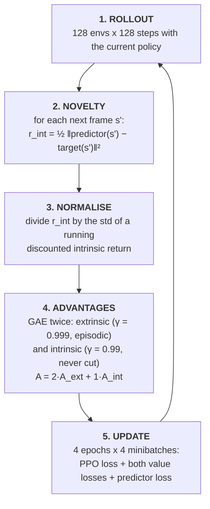

# PPO + Random Network Distillation

**Random Network Distillation** ([Burda, Edwards, Storkey & Klimov,
2018](https://arxiv.org/abs/1810.12894)) is an exploration bonus for reinforcement learning. A
randomly initialised network is frozen. A second network is trained to predict its output. On states
the agent has visited often the prediction is good; on new states it is bad. That prediction error
is paid to the agent as an **intrinsic reward**, on top of the game's own reward, so it is drawn
towards what it hasn't seen yet.

It was the first method to beat average human performance on **Montezuma's Revenge** without
demonstrations or access to the emulator state. That game gives no reward until the agent has
found a key through a sequence of rooms, ladders and ropes, so plain PPO sees nothing but zeros and
never learns.

This follows CleanRL's [`ppo_rnd_envpool.py`](https://github.com/vwxyzjn/cleanrl/blob/master/cleanrl/ppo_rnd_envpool.py)
([docs](https://docs.cleanrl.dev/rl-algorithms/ppo-rnd/)), with OpenAI's
[original code](https://github.com/openai/random-network-distillation) consulted where they differ.
Default task is `ALE/MontezumaRevenge-v5`.

---

## How this differs from `ppo-atari/`

| | PPO (`../ppo-atari/`) | PPO + RND (here) |
| --- | --- | --- |
| Reward | the game's, clipped | the game's (clipped) plus a normalised novelty bonus |
| Value heads | one | two: extrinsic and intrinsic, with separate returns |
| Discount | 0.99 | 0.999 extrinsic, 0.99 intrinsic |
| Episode ends | cut the return | cut the extrinsic return only; the intrinsic return carries on |
| Extra networks | none | a frozen random target and a trained predictor, each reading one frame |
| Normalisation | none | per-pixel observation whitening for RND; intrinsic reward scaling |
| Trunk | Nature CNN → 512 | Nature CNN → 256 → 448, plus a residual layer for the value heads |
| Scale | 8 envs, 10M steps | 128 envs, 2B steps (CleanRL's defaults) |
| Sticky actions | no | yes, 25% (Machado et al., 2018) |

---

## Layout

```text
ppo-rnd/
├── algorithm.py       # arguments, Atari preprocessing, and the training loop (entry point)
├── src/
│   ├── agent.py       # policy with extrinsic and intrinsic value heads
│   └── rnd.py         # RNDModel (target + predictor), RunningMeanStd, RewardForwardFilter
├── pyproject.toml     # Poetry dependencies and [tool.hf-jobs] defaults
└── requirements.txt   # pip freeze of a working environment
```

---

## Installation

```bash
cd ppo-rnd
python -m venv .venv
.venv\Scripts\activate        # Windows
# source .venv/bin/activate   # macOS / Linux
pip install -r requirements.txt
```

Or `poetry install`. Pins match `ppo-atari/`: `torch` 2.13.0, `gymnasium` 1.3.0, `ale-py` 0.12.1
(which bundles the Atari ROMs), `stable-baselines3` 2.9.0 for the Atari wrappers. OpenCV is the
headless build, because the full one needs `libGL`, which Hugging Face Jobs images lack.

---

## Quick start

The defaults are CleanRL's: 128 environments and 2 billion steps. That is a multi-day GPU run, not
something to start on a laptop. Locally, use a few environments to see it work:

```bash
cd ppo-rnd
python algorithm.py --num-envs 4 --num-iterations-obs-norm-init 2 --total-timesteps 100000
tensorboard --logdir runs
```

For real runs, send it to Hugging Face Jobs:

```bash
python algorithm.py --hf-job --save-model                   # 128 envs on an l4x1, 24-hour limit
python algorithm.py --hf-job --hf-dry-run                   # show what would be uploaded and run
python algorithm.py --env-id ALE/Venture-v5 --hf-job        # another hard-exploration game
```

Run from this directory, since `algorithm.py` imports `src.agent` and `src.rnd`. Runs are written to
`runs/{env_id}__{exp_name}__{seed}__{timestamp}/` (with `/` in the environment id replaced by `-`).

---

## How RND works



### The novelty bonus

The target network `f` is a randomly initialised CNN that is never trained. The predictor `f̂`, a
deeper CNN, is trained to match it. The intrinsic reward for reaching `s'` is the predictor's error:

```math
r^{\mathrm{int}}_t = \tfrac{1}{2} \big\| \hat f(s_{t+1}) - f(s_{t+1}) \big\|_2^2
```

The predictor is trained on the frames the agent actually visits, so its error shrinks on familiar
states and stays large on unfamiliar ones. The reward fades for whatever the agent has done often
and stays high at the frontier of what it has explored.

**Why a random target, rather than predicting the next frame.** Earlier curiosity methods paid the
error of predicting the *next state* from the current state and action. In a stochastic environment
that error never shrinks (a TV showing random noise stays unpredictable forever) so the agent gets
stuck watching it. RND's target is a deterministic function of the state alone, so given enough
visits its error always goes to zero.

Both networks read only the newest frame of the policy's 4-frame stack, normalised per pixel with
running statistics and clipped to `[-5, 5]`. Without that, the frozen target's output would mostly
reflect overall brightness and barely vary between rooms. The statistics are initialised from
`--num-iterations-obs-norm-init` rollouts of random play (50 × 128 steps by default) before training,
then updated after every rollout.

### Reward normalisation

The raw error has an arbitrary scale that drifts as the predictor learns. Before use, intrinsic
rewards are divided by the running standard deviation of a discounted sum of intrinsic rewards,
kept separately for each environment and stepped through time:

```math
R_t = \gamma_{\mathrm{int}} \, R_{t-1} + r^{\mathrm{int}}_t, \qquad r^{\mathrm{int}}_t \leftarrow r^{\mathrm{int}}_t \,/\, \sigma(R)
```

This keeps the intrinsic return on a stable scale, so `--int-coef` means the same thing at the start
of training as at the end. Only dividing by the standard deviation (no mean subtraction) keeps every
intrinsic reward positive.

### Two value heads

The game's reward and the novelty bonus are different kinds of signal, so each gets its own value
head and its own return:

| | Extrinsic | Intrinsic |
| --- | --- | --- |
| Discount | `--gamma` 0.999 | `--int-gamma` 0.99 |
| Episodic? | yes: a lost life or game over cuts the return | no: novelty beyond a game over still counts |
| Value loss | clipped, as in PPO | plain MSE |

The intrinsic return is **non-episodic** because dying shouldn't look attractive. If losing a life
ended the intrinsic return, an agent in a well-explored room could escape its low novelty by dying
and respawning. With the return carried across episode boundaries, dying just costs time.

GAE runs once per head, and the policy is trained on one combined advantage:

```math
A_t = c_{\mathrm{ext}} \, A^{\mathrm{ext}}_t + c_{\mathrm{int}} \, A^{\mathrm{int}}_t, \qquad c_{\mathrm{ext}} = 2,\ c_{\mathrm{int}} = 1
```

### The loss

Each minibatch step minimises

```math
L = L^{\mathrm{CLIP}} - c_H \, H[\pi] + c_V \big( L^{V_{\mathrm{ext}}} + L^{V_{\mathrm{int}}} \big) + L^{\mathrm{RND}}
```

with one Adam optimizer over the policy, both value heads and the predictor (the target has no
gradients). `L^RND` is the predictor's mean-squared error on a random `--update-proportion` (25%) of
the minibatch. With 128 environments that is as much predictor data per update as 32 environments
would give, which slows how fast the predictor learns states away. If it learned them too fast, the
bonus would fade before the policy had acted on it.

---

## Atari preprocessing

CleanRL builds its environments with `envpool`, which has no Windows build. The same settings are
rebuilt here from Gymnasium and Stable-Baselines3 wrappers:

| Setting | Value | Wrapper |
| --- | --- | --- |
| Sticky actions | 25% | `gym.make(repeat_action_probability=0.25)` |
| Frame skip | 4, max-pooled over the last 2 | `MaxAndSkipEnv(skip=4)`, with `frameskip=1` in `gym.make` |
| Random no-ops at reset | up to 30 | `NoopResetEnv` |
| Lost life ends the episode | yes | `EpisodicLifeEnv` |
| FIRE on reset | when the game has it | `FireResetEnv` |
| Reward clipping | sign | `ClipRewardEnv` |
| Frames | 84×84 grayscale, stack of 4 | `GrayscaleObservation`, `ResizeObservation`, `FrameStackObservation` |
| Time limit | 27,000 agent steps (108,000 frames) | `gym.make(max_episode_steps=108000)` |

`frameskip=1` matters. `ALE/*-v5` environments skip 4 frames by default, so wrapping one in
`MaxAndSkipEnv(4)` without it would skip 16 frames per action.

Episode returns are logged from a `RecordEpisodeStatistics` that sits inside `EpisodicLifeEnv` and
`ClipRewardEnv`, so `charts/episodic_return` is the real, unclipped score of a whole game.

---

## Command-line reference

### Experiment setup

| Flag | Default | Description |
| --- | --- | --- |
| `--exp-name` | `ppo_rnd` | Name of this experiment; part of the run directory name. |
| `--seed` | `1` | Seeds Python, NumPy, Torch, and the environments. |
| `--torch-deterministic` | `True` | Sets `torch.backends.cudnn.deterministic`. |
| `--cuda` | `True` | Use CUDA when available. |
| `--track` | `False` | Mirror metrics to Weights & Biases. |
| `--wandb-project-name` | `cleanRL` | W&B project. |
| `--wandb-entity` | `None` | W&B team/entity. |
| `--capture-video` | `False` | Record episodes from the first environment. |
| `--save-model` | `False` | Save the agent, both RND networks and the observation statistics. |
| `--save-interval` | `100` | With `--save-model`, also checkpoint every this many iterations (0: only at the end). |

### PPO

| Flag | Default | Description |
| --- | --- | --- |
| `--env-id` | `ALE/MontezumaRevenge-v5` | Gymnasium Atari environment id. |
| `--total-timesteps` | `2000000000` | Total environment steps. |
| `--learning-rate` | `1e-4` | Adam learning rate, annealed linearly to 0. |
| `--num-envs` | `128` | Parallel environments. |
| `--num-steps` | `128` | Steps per environment per rollout; a batch is `num_envs × num_steps` = 16,384. |
| `--async-envs` | `True` | Run environments in subprocesses (`AsyncVectorEnv`); `false` runs them in-process. |
| `--anneal-lr` | `True` | Anneal the learning rate. |
| `--gamma` | `0.999` | Extrinsic discount. |
| `--gae-lambda` | `0.95` | GAE λ, for both returns. |
| `--num-minibatches` | `4` | Minibatches per epoch. |
| `--update-epochs` | `4` | Epochs per rollout. |
| `--norm-adv` | `True` | Normalise the combined advantage per minibatch. |
| `--clip-coef` | `0.1` | PPO clip range, also used for the extrinsic value clip. |
| `--clip-vloss` | `True` | Clip the extrinsic value loss. |
| `--ent-coef` | `0.001` | Entropy coefficient. |
| `--vf-coef` | `0.5` | Value loss coefficient. |
| `--max-grad-norm` | `0.5` | Gradient clipping, over all trained parameters. |
| `--target-kl` | `None` | Stop the epoch loop early above this KL. |
| `--sticky-action-prob` | `0.25` | Probability the emulator repeats the previous action. |

### RND

| Flag | Default | Description |
| --- | --- | --- |
| `--update-proportion` | `0.25` | Fraction of each minibatch used to train the predictor. |
| `--int-coef` | `1.0` | Weight of the intrinsic advantage. |
| `--ext-coef` | `2.0` | Weight of the extrinsic advantage. |
| `--int-gamma` | `0.99` | Intrinsic discount. |
| `--num-iterations-obs-norm-init` | `50` | Rollouts of random play used to initialise the observation statistics. |

---

## Verification

Run on a Windows laptop CPU (Python 3.12, torch 2.13.0 CPU build):

| Check | Result |
| --- | --- |
| Environment construction | `(4, 84, 84)` observations, 18 actions for Montezuma's Revenge. |
| `--num-envs 4 --num-iterations-obs-norm-init 2 --total-timesteps 3072 --save-model` | Observation-statistics initialisation, 6 rollout/update cycles and the checkpoint all completed with subprocess environments. Every logged scalar was finite. Over the 6 updates the raw intrinsic reward fell from 232 to 72 and the predictor loss from 0.41 to 0.25. Policy entropy stayed at 2.89 (uniform over 18 actions) and the extrinsic value loss stayed near zero, since no game reward had been found yet. |
| `--async-envs false --save-interval 2` | In-process environments work, and checkpoints are written every 2 iterations and at the end, with `global_step` recorded. |
| Novelty test: predictor trained on 4,000 Breakout frames, then scored on new Breakout frames and on Montezuma frames | The intrinsic reward on new Breakout frames fell from 54 to 8.5 (−84%); Montezuma frames scored about 5,000, roughly 600 times higher. Part of that gap was there before training: Montezuma's pixels are far from the Breakout statistics used to normalise them. |

**Speed and cost.** On that laptop CPU, with 4 environments, training runs at about **44 steps per
second**. That is enough to check the code, not to learn Montezuma's Revenge, where the paper's
results come from training on more than a billion frames. On Hugging Face Jobs the default `l4x1`
(8 vCPUs, 30 GB RAM, one L4 GPU) costs $0.80 an hour. With 128 environments the emulators are likely
to be the bottleneck there; `--hf-flavor a10g-large` gives 12 vCPUs for $1.50 an hour. A 24-hour Job
covers a fraction of the default 2 billion steps, so use `--save-model`: the periodic checkpoints in
`runs/` are copied back to the bucket even when the Job hits its time limit.

---

## Differences from CleanRL's `ppo_rnd_envpool.py`

The networks, losses and default hyperparameters are CleanRL's. The differences:

- **Environments:** Gymnasium 1.x and `ale-py` with Stable-Baselines3 wrappers instead of `envpool`
  (no Windows build), with `SAME_STEP` autoreset so that `dones[t]` marks the first observation of a
  new episode, as CleanRL's PPO assumes.
- **Reward normalisation runs through time.** CleanRL loops over `curiosity_rewards.T`, which with
  rewards stored as `(num_steps, num_envs)` steps the forward filter across environments rather than
  through time. OpenAI's original stores them as `(num_envs, num_steps)`, so its identical-looking
  `.T` steps through time. This follows OpenAI, and updates the running variance from every value of
  the filter as OpenAI does, rather than from a mean, standard deviation and count of `num_envs`.
- **Training continues from random play.** CleanRL steps the environments during
  observation-statistics initialisation but starts training from the observation it got at reset.
  Here training starts from where random play left the games.
- **The novelty of a terminal state** is computed on the real final frame (`final_obs`), not on the
  first frame of the next episode.
- **One forward pass** per step computes the action and both values; CleanRL runs the network twice.
- **Additions:** `argparse` instead of `tyro`; a local `strtobool`; `--save-model` and
  `--save-interval`; `--async-envs`; `--sticky-action-prob`; the raw and normalised intrinsic rewards
  and both value losses are logged separately; `launch()` for `--hf-job`.

---

## Metrics

| Scalar | Meaning |
| --- | --- |
| `charts/episodic_return` | Unclipped score of each completed game. Expect long stretches of 0 on Montezuma's Revenge. |
| `charts/avg_episodic_return` | Mean of the last 20 game scores. |
| `charts/episodic_length` | Game length in agent steps. |
| `charts/episode_curiosity_reward` | Raw intrinsic reward of the last step of a game. |
| `charts/curiosity_reward_raw` | Mean raw intrinsic reward of the rollout. Falls as the predictor learns; rises when the agent reaches new rooms. |
| `charts/curiosity_reward_normalized` | Mean intrinsic reward after normalisation, as seen by the intrinsic value head. |
| `losses/fwd_loss` | The predictor's MSE against the target. |
| `losses/ext_value_loss`, `losses/int_value_loss` | The two value losses; `losses/value_loss` is their sum. |
| `losses/policy_loss`, `losses/entropy`, `losses/approx_kl`, `losses/old_approx_kl`, `losses/clipfrac` | The usual PPO diagnostics. |
| `charts/learning_rate`, `charts/SPS` | Annealed learning rate; steps per second. |

---

## References

- Burda, Edwards, Storkey & Klimov, *Exploration by Random Network Distillation* (2018). [arXiv:1810.12894](https://arxiv.org/abs/1810.12894), [code](https://github.com/openai/random-network-distillation)
- Burda, Edwards, Pathak, Storkey, Darrell & Efros, *Large-Scale Study of Curiosity-Driven Learning* (2018). [arXiv:1808.04355](https://arxiv.org/abs/1808.04355)
- Pathak, Agrawal, Efros & Darrell, *Curiosity-driven Exploration by Self-supervised Prediction* (ICM, 2017). [arXiv:1705.05363](https://arxiv.org/abs/1705.05363)
- Bellemare et al., *Unifying Count-Based Exploration and Intrinsic Motivation* (2016). [arXiv:1606.01868](https://arxiv.org/abs/1606.01868)
- Machado et al., *Revisiting the Arcade Learning Environment* (sticky actions, 2018). [arXiv:1709.06009](https://arxiv.org/abs/1709.06009)
- Schulman et al., *Proximal Policy Optimization Algorithms* (2017). [arXiv:1707.06347](https://arxiv.org/abs/1707.06347)
- Huang et al., *CleanRL* (2022). [JMLR](https://www.jmlr.org/papers/v23/21-1342.html), [PPO + RND docs](https://docs.cleanrl.dev/rl-algorithms/ppo-rnd/)

## License

MIT, see [LICENSE](../LICENSE) at the repository root. This directory is derived from CleanRL (MIT);
its notice is recorded in [NOTICE](../NOTICE).
