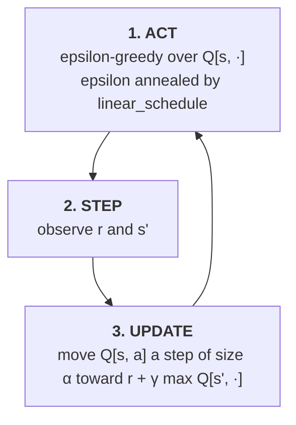

# Tabular Q-learning

**Q-learning** ([Watkins, 1989](https://www.cs.rhul.ac.uk/~chrisw/new_thesis.pdf); [Watkins & Dayan,
1992](https://link.springer.com/article/10.1007/BF00992698)) with a lookup table, written in the same
single-file style as the deep projects in this repository. It is the algorithm DQN is built on: DQN
replaces the table with a neural network and adds a replay buffer and a target network to keep that
network stable. With a table neither is needed, so this is the update rule on its own.

Default task is `Taxi-v4`.

CleanRL has no tabular Q-learning script, so this follows the conventions of `../dqn/algorithm.py`
instead: the same flags, seeding, vector environment, episode logging, epsilon schedule and
`--save-model` evaluation path, with a NumPy table where the network was.

---

## How this differs from DQN

| | DQN (`../dqn/`) | Q-learning (here) |
| --- | --- | --- |
| `Q(s, a)` | a neural network | a `(n_states, n_actions)` NumPy array |
| States | any observation, generalised by the network | a finite set, each with its own row |
| Update | gradient step on a sampled minibatch | one in-place table update per transition |
| Data | replay buffer, each transition reused | each transition used once, then discarded |
| Stability device | a delayed target network | none needed: an update changes only one entry |
| Tasks | CartPole, Atari | Taxi, FrozenLake, CliffWalking, Blackjack |
| Dependencies | torch for the network | NumPy for the table; torch only for TensorBoard logging |

---

## Layout

```text
q-learning/
├── algorithm.py       # arguments, Q-table, and the training loop (entry point)
├── eval.py            # greedy evaluation of a saved table; also runnable on its own
├── pyproject.toml     # Poetry dependency declaration
└── requirements.txt   # pip pins of the same versions
```

---

## Installation

```bash
cd q-learning
python -m venv .venv
.venv\Scripts\activate        # Windows
# source .venv/bin/activate   # macOS / Linux
pip install -r requirements.txt
```

Or `poetry install`. Pins match the other Gymnasium 1.x projects: `gymnasium` 1.3.0, `numpy` 2.5.2,
`torch` 2.13.0. Torch is only there for `torch.utils.tensorboard.SummaryWriter`, the logger every
project here uses.

---

## Quick start

```bash
cd q-learning
python algorithm.py                       # Taxi-v4, 200k steps, about 2 minutes on a laptop
python algorithm.py --save-model          # then evaluate the table greedily
tensorboard --logdir runs
```

```bash
python algorithm.py --env-id CliffWalking-v1 --total-timesteps 100000
python algorithm.py --env-id FrozenLake-v1 --total-timesteps 300000
python algorithm.py --env-id Blackjack-v1 --total-timesteps 500000 --save-model
python eval.py runs/<run_name>/q_learning.npy --env-id Taxi-v4 --eval-episodes 100
```

Run from this directory, since `algorithm.py` and `eval.py` import each other with flat imports.
Runs are written to `runs/{env_id}__{exp_name}__{seed}__{timestamp}/`.

Any Gymnasium environment with a `Discrete` action space and a `Discrete` observation space works. A
`Tuple` of `Discrete` spaces, as in `Blackjack-v1`'s `(player sum, dealer card, usable ace)`, is
flattened into a single table row index.

---

## How training works



There is no buffer, no batch and no learning-starts delay: every transition updates the table once,
immediately, and is then forgotten.

### Acting

Epsilon decays linearly from `--start-e` (1.0) to `--end-e` (0.05) over the first
`exploration_fraction × total_timesteps` steps, exactly as in `dqn/`. With probability epsilon a
uniform random action is taken; otherwise the greedy one. Ties are broken uniformly at random, which
matters at the start: every row begins at zero, and always picking action 0 on a tie would make the
"greedy" policy a fixed, arbitrary one.

### The update

```math
Q(s, a) \leftarrow Q(s, a) + \alpha \big[\, r + \gamma \, (1 - d) \max_{a'} Q(s', a') - Q(s, a) \,\big]
```

The bracket is the TD error: how far the current estimate is from a one-step bootstrapped target.
`α` is `--learning-rate` (0.1). The `max` makes it off-policy: the target assumes greedy play from
`s'` onward, whatever epsilon-greedy actually does next, which is why Q-learning learns the optimal
values while still exploring.

As in `dqn/`, only `terminations` is used as `d`. When `Taxi-v4` cuts an episode at 200 steps, the
state still has a future, so its bootstrap is kept.

### Why no target network

DQN needs a frozen target because a gradient step on one state changes the network's output on every
other state, including the ones in its own target. A table update changes exactly one entry, so the
target `max Q(s', ·)` doesn't move when `Q(s, a)` does (unless `s' = s`). Under the usual conditions
(every pair visited infinitely often, step sizes decaying appropriately) tabular Q-learning converges
to the optimal `Q*`, a guarantee DQN does not have.

---

## Command-line reference

| Flag | Default | Description |
| --- | --- | --- |
| `--exp-name` | `q_learning` | Name of this experiment; part of the run directory name. |
| `--seed` | `1` | Seeds Python, NumPy and the env spaces. |
| `--track` | `False` | Mirror metrics to Weights & Biases. |
| `--wandb-project-name` | `cleanRL` | W&B project. |
| `--wandb-entity` | `None` | W&B team/entity. |
| `--capture-video` | `False` | Record episodes from the first environment. |
| `--save-model` | `False` | Save the table as `.npy`, then evaluate it greedily. |
| `--env-id` | `Taxi-v4` | Gymnasium environment id, with discrete observations and actions. |
| `--total-timesteps` | `200000` | Total environment steps. |
| `--learning-rate` | `0.1` | Step size `α` of the update. |
| `--num-envs` | `1` | Parallel environments; each step updates one entry per environment. |
| `--gamma` | `0.99` | Discount factor. |
| `--start-e` | `1` | Initial epsilon. |
| `--end-e` | `0.05` | Final epsilon. |
| `--exploration-fraction` | `0.5` | Fraction of `--total-timesteps` over which epsilon is annealed. |

The flags DQN has and this doesn't (`--buffer-size`, `--batch-size`, `--tau`,
`--target-network-frequency`, `--learning-starts`, `--train-frequency`, `--cuda`) belong to the
machinery a table doesn't need.

---

## Results

One seed each (`--seed 1`), evaluated greedily (`epsilon = 0`) after training:

| Task | Steps | Greedy evaluation | Reference |
| --- | --- | --- | --- |
| `Taxi-v4` | 200,000 | **7.8** mean over 10 episodes (6 to 10) | optimal play scores about 8; this run's first, random episodes scored about -850 |
| `CliffWalking-v1` | 100,000 | **-13** on all 100 episodes | -13 is optimal: the 13-step shortest path along the cliff edge |
| `FrozenLake-v1` (slippery) | 300,000 | goal reached in **63%** of 100 episodes | the best possible policy succeeds in roughly 74–82% |
| `Blackjack-v1` | 500,000 | **-0.063** per hand over 10,000 hands (±0.010); wins 42%, draws 9%, losses 49% | the best possible fixed strategy loses about 4–5% per hand; random play loses 39.6% |

Evaluate stochastic tasks over many episodes: Blackjack's first 100-hand evaluation gave
-0.27 ± 0.93, which looked poor, while 10,000 hands (`python eval.py ... --eval-episodes 10000`)
pinned it at -0.063. Taxi trains at about 2,200 steps per second on a laptop CPU, so the default run
takes about a minute and a half. CliffWalking's greedy policy walks the risky edge path, which is the optimal one; SARSA, the
on-policy alternative, would learn the longer safe path because it accounts for its own exploration.

---

## Metrics

| Scalar | Meaning |
| --- | --- |
| `charts/episodic_return` | Return per completed episode, including exploration. |
| `charts/episodic_length` | Episode length. |
| `charts/epsilon` | The current exploration rate. |
| `charts/SPS` | Steps per second. |
| `losses/td_error` | Mean absolute TD error of the updates. Falls as the table converges, but not to zero on stochastic tasks (FrozenLake, Blackjack), where the target itself is noisy. |
| `losses/q_values` | Mean Q value of the updated entries. |

---

## References

- Watkins, *Learning from Delayed Rewards* (PhD thesis, 1989). [PDF](https://www.cs.rhul.ac.uk/~chrisw/new_thesis.pdf)
- Watkins & Dayan, *Q-learning* (1992). [Machine Learning 8, 279–292](https://link.springer.com/article/10.1007/BF00992698)
- Sutton & Barto, *Reinforcement Learning: An Introduction*, 2nd ed. (2018), §6.5 Q-learning, Example 6.6 Cliff Walking, Example 5.1 Blackjack. [Online](http://incompleteideas.net/book/the-book-2nd.html)

## License

MIT, see [LICENSE](../LICENSE) at the repository root. This directory is original work, in the
CleanRL single-file style; provenance for the repository as a whole is recorded in [NOTICE](../NOTICE).
